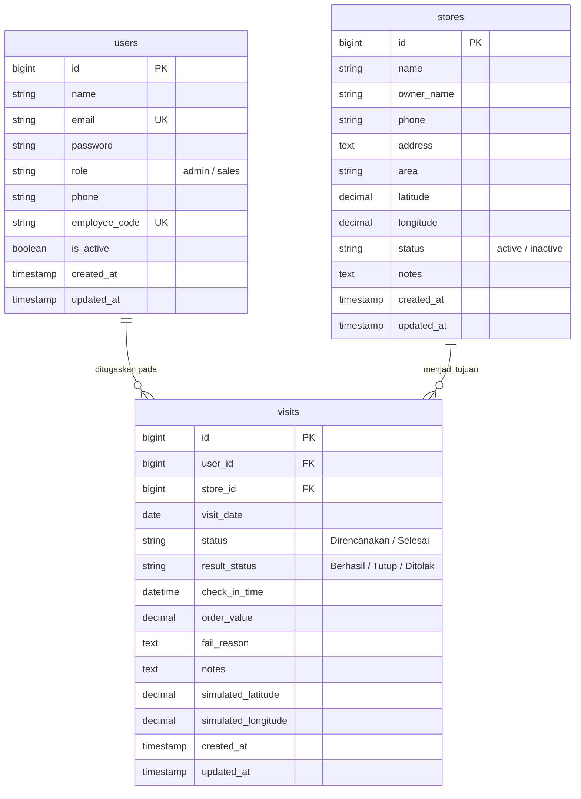

# RuteSales - Sistem Pemantauan Kunjungan Sales Lapangan

**RuteSales** adalah aplikasi berbasis web yang dirancang untuk memantau, mengelola, dan mengevaluasi aktivitas kunjungan tim sales lapangan ke toko dan warung mitra. Aplikasi ini dibangun dengan standar arsitektur **MVC (Model-View-Controller)** menggunakan **Laravel Versi Terbaru (Laravel 11.x)**, lingkungan pengembangan lokal **Laravel Herd**, basis data **SQLite** yang dihubungkan melalui **TablePlus**, template engine **Blade**, serta framework CSS **Tailwind CSS**.

---

## Daftar Isi
1. [Panduan Instalasi Aplikasi & Lingkungan Lokal](#1-panduan-instalasi-aplikasi--lingkungan-lokal)
2. [Daftar Fitur Utama](#2-daftar-fitur-utama)
3. [Penjelasan Struktur Database](#3-penjelasan-struktur-database)
4. [Laporan Hasil Skenario Pengujian](#4-laporan-hasil-skenario-pengujian)
5. [Akun Demo & Akses Cepat](#5-akun-demo--akses-cepat)

---

## 1. Panduan Instalasi Aplikasi & Lingkungan Lokal

Ikuti langkah-langkah berikut untuk menginstal dan menjalankan aplikasi **RuteSales** di lingkungan pengembangan lokal:

### A. Persyaratan Sistem & Tooling
- **Framework Utama**: Laravel Versi Terbaru (Laravel 11.x).
- **Lingkungan Lokal**: **Laravel Herd** (untuk macOS / Windows).
- **Basis Data**: **SQLite** dihubungkan melalui **TablePlus**.
- **Composer**: Versi 2.x.
- **PHP**: Versi 8.2 atau lebih baru (termasuk modul `pdo_sqlite`, `mbstring`, `openssl`, `tokenizer`, `xml`, `ctype`, `json`).

### B. Konfigurasi Lingkungan Lokal via Laravel Herd
Aplikasi ini dioptimalkan untuk berjalan pada **Laravel Herd**:
1. Pastikan **Laravel Herd** sudah terpasang dan berjalan di komputer Anda.
2. Tempatkan atau hubungkan direktori proyek ke dalam Herd:
   - Jika proyek berada di folder `d:\Pemrograman\Aplikasi\RuteSales`, buka terminal dan jalankan:
     ```bash
     cd d:\Pemrograman\Aplikasi\RuteSales
     herd link rutesales
     ```
   - Atau tambahkan path direktori `D:\Pemrograman\Aplikasi` ke dalam daftar *Parked Paths* pada menu pengaturan Laravel Herd.
3. Setelah terhubung, aplikasi dapat langsung diakses secara otomatis melalui domain lokal:
   👉 **[http://rutesales.test](http://rutesales.test)**

*(Alternatif tanpa Herd: Anda tetap dapat menjalankan server lokal bawaan menggunakan perintah `php artisan serve`, dan mengaksesnya di `http://127.0.0.1:8000`).*

### C. Langkah Instalasi Langkah-Demi-Langkah

1. **Buka Terminal / PowerShell** pada direktori proyek:
   ```bash
   cd d:\Pemrograman\Aplikasi\RuteSales
   ```

2. **Pasang Dependensi PHP Menggunakan Composer**:
   ```bash
   composer install
   ```

3. **Konfigurasi Berkas Lingkungan (`.env`)**:
   Salin berkas konfigurasi `.env.example` menjadi `.env`:
   ```bash
   # Di Windows PowerShell:
   Copy-Item .env.example .env
   ```
   Atur port dan URL pada `.env`:
   ```env
   APP_NAME=RuteSales
   APP_ENV=local
   APP_KEY=base64:SDAtrsFVayVhGJ8y5WFTqDi6HXq6z4G0nMm2iARFxBI=
   APP_DEBUG=true
   APP_TIMEZONE=Asia/Jakarta
   APP_URL=http://rutesales.test

   # Basis data menggunakan SQLite:
   DB_CONNECTION=sqlite
   ```

4. **Generate Application Key**:
   ```bash
   php artisan key:generate
   ```

5. **Jalankan Migrasi dan Seeding Basis Data**:
   Perintah ini akan membuat skema tabel relasional dan mengisinya dengan data awal (*dummy*) yang realistis:
   ```bash
   php artisan migrate:fresh --seed
   ```

6. **Panduan Menghubungkan Basis Data ke TablePlus (SQLite)**:
   Aplikasi menggunakan SQLite yang terintegrasi langsung dengan TablePlus:
   1. Buka aplikasi **TablePlus**.
   2. Klik tombol **Create a new connection...** (atau ikon **+**).
   3. Pilih jenis database: **SQLite**.
   4. Berikan nama koneksi, misalnya: `RuteSales SQLite`.
   5. Pada kolom **Database Path**, klik tombol **Choose...** atau *browse* dan pilih berkas:
      `D:\Pemrograman\Aplikasi\RuteSales\database\database.sqlite`
   6. Klik tombol **Test** untuk memastikan koneksi sukses (indikator hijau).
   7. Klik tombol **Connect** untuk membuka seluruh tabel (`users`, `stores`, `visits`, dll.).
   *(Tips: Anda juga bisa langsung menyeret / drag-and-drop berkas `database.sqlite` dari File Explorer langsung ke jendela TablePlus).*

7. **Menjalankan Pengujian Otomatis (Feature & Unit Tests)**:
   ```bash
   php artisan test
   ```

---

## 2. Daftar Fitur Utama

Aplikasi RuteSales memenuhi seluruh kebutuhan arsitektural dan fungsional proyek:

### A. Pola Arsitektur MVC & Definisi Routing Terstruktur
- **Model**: Mengimplementasikan Eloquent ORM lengkap dengan relasi antarentitas (`User`, `Store`, `Visit`), query scopes, casting data, dan helper methods.
- **View**: Template Blade modular dengan pemanfaatan **Reusable Components** (`<x-layout>`, `<x-stat-card>`, `<x-badge>`, `<x-alert>`), desain responsif *mobile-first* untuk perangkat sales di lapangan maupun layar desktop monitor supervisor.
- **Controller**: Controller terdedikasi (`DashboardController`, `StoreController`, `SalesUserController`, `VisitController`, `AuthController`) dengan pemisahan validasi melalui **Form Request Classes** (`StoreRequest`, `UserRequest`, `ScheduleVisitRequest`, `CheckInVisitRequest`).

### B. Tiga Modul Utama (CRUD Terkait)
1. **Modul Pengelolaan Toko / Warung (`/stores`)**:
   - Menampilkan daftar toko dengan fitur pencarian teks multi-kolom (nama toko, pemilik, telepon, alamat).
   - Filter wilayah/cluster dan filter status operasional (Aktif / Non-Aktif).
   - Formulir tambah toko baru (*Create*) dan edit data toko (*Update*).
   - Detail profil toko (*Show*) yang menampilkan koordinat GPS simulasi serta riwayat seluruh kunjungan sales ke toko tersebut.
   - Hapus data toko (*Delete*) dengan proteksi konfirmasi.
2. **Modul Pengelolaan Tim Sales & Admin (`/sales`)**:
   - Menampilkan daftar staf sales dan administrator beserta kode pegawai (*employee code*).
   - Formulir registrasi sales/admin baru dengan validasi keunikan email dan kode pegawai.
   - Pembaruan profil, penggantian peran (*role*), dan aktivasi/deaktivasi status akun.
   - Detail profil sales yang merangkum beban kerja dan seluruh riwayat rute yang ditugaskan.
3. **Modul Pengelolaan Agenda Rute Kunjungan (`/rute`)**:
   - Penjadwalan agenda kunjungan baru menghubungkan sales pelaksana dan toko target pada tanggal tertentu.
   - Filter agenda berdasarkan nama sales, status kunjungan (*Direncanakan* / *Selesai*), hasil transaksi, dan tanggal.
   - Edit jadwal penugasan rute dan pembatalan/penghapusan rute.

### C. Alur Proses Transaksi & Formulir Check-In Kunjungan
- **Siklus Status Kunjungan**:
  - Kunjungan yang baru dijadwalkan berstatus **Direncanakan**.
  - Saat sales tiba di lokasi toko, sales membuka form check-in untuk memperbarui status menjadi **Selesai**.
- **Hasil Kunjungan yang Dicatat**:
  - **Berhasil**: Transaksi sukses, wajib mencatat nilai pesanan (rupiah) dan catatan barang yang dipesan.
  - **Tutup**: Toko mitra tutup, wajib mengisi alasan penutupan (misal: pemilik keluar kota, renovasi).
  - **Ditolak**: Pemilik toko menolak melakukan pesanan, wajib mengisi alasan penolakan (misal: stok masih penuh, tempo pembayaran).
- **Validasi Server-Side & Keamanan**:
  - Dilindungi token **CSRF** (`@csrf`).
  - Menampilkan pesan galat spesifik dan informatif jika terdapat input yang melanggar aturan bisnis (misal: status Berhasil tanpa nominal pesanan, nominal negatif, atau status Tutup/Ditolak tanpa alasan).
  - Pencatatan waktu check-in aktual dan koordinat lokasi simulasi sales (*latitude* & *longitude*).

### D. URI Dinamis Spesifik Sesuai Persyaratan Proyek
- **Endpoint**: `/rute/detail/{id}` (Contoh: `/rute/detail/1`).
- Merender profil lengkap toko yang harus dikunjungi berdasarkan parameter `{id}` pada URI.
- Menampilkan jadwal kunjungan, sales penanggung jawab, catatan instruksi, riwayat kunjungan terdahulu ke toko tersebut, serta formulir check-in transaksi interaktif jika belum diselesaikan.
- Mengembalikan kode respon standar **404 Not Found** apabila ID rute tidak terdaftar di database.

### E. Dashboard Admin dengan 3 Metrik Utama
Halaman ringkasan eksekutif administrator (`/dashboard`) menyajikan:
1. **Total Kunjungan Selesai**: Menghitung jumlah kumulatif seluruh rute yang telah diselesaikan tim sales.
2. **Persentase Keberhasilan Kunjungan (%)**: Rasio keberhasilan transaksi dihitung dengan formula `(Kunjungan Berhasil / Total Kunjungan Selesai) * 100%`.
3. **Total Nilai Pesanan (Rp)**: Akumulasi nilai rupiah dari seluruh transaksi pesanan yang berhasil disepakati.
4. **Metrik Tambahan**: Total Toko Terdaftar, Total Sales Aktif, Agenda Hari Ini, Distribusi Status (Berhasil, Tutup, Ditolak, Direncanakan), Tabel Kunjungan Terkini, dan Tabel Ringkasan Omzet Performa Tim Sales.

---

## 3. Penjelasan Struktur Database

Sistem menggunakan skema basis data relasional dengan 3 entitas utama yang saling terhubung:



### Rincian Tabel dan Kolom:

### 1. Tabel `users` (Sales & Staf Admin)
Menyimpan data identitas dan akun otentikasi tim sales dan administrator.
- `id` (BIGINT, Primary Key, Auto Increment): ID unik pengguna.
- `name` (VARCHAR): Nama lengkap sales/admin.
- `email` (VARCHAR, Unique): Alamat email untuk autentikasi.
- `password` (VARCHAR): Hash kata sandi pengguna (Bcrypt).
- `role` (VARCHAR): Peran akses pengguna (`admin` atau `sales`).
- `phone` (VARCHAR, Nullable): Nomor kontak/WhatsApp.
- `employee_code` (VARCHAR, Unique, Nullable): Nomor Induk Karyawan / Kode Sales (contoh: `SLS-101`, `ADM-001`).
- `is_active` (BOOLEAN): Status keaktifan pengguna untuk menerima penugasan rute.
- `remember_token` & `timestamps` (`created_at`, `updated_at`).

### 2. Tabel `stores` (Toko & Warung Mitra)
Menyimpan direktori toko kelontong, warung, minimarket, atau grosir yang menjadi sasaran kunjungan.
- `id` (BIGINT, Primary Key, Auto Increment): ID unik toko.
- `name` (VARCHAR): Nama toko/warung (contoh: *Toko Berkah Jaya*).
- `owner_name` (VARCHAR): Nama pemilik atau penanggung jawab outlet.
- `phone` (VARCHAR, Nullable): Nomor telepon pemilik toko.
- `address` (TEXT): Alamat fisik lengkap toko.
- `area` (VARCHAR, Nullable): Wilayah cluster / kota (contoh: *Jakarta Selatan*, *Depok*).
- `latitude` & `longitude` (DECIMAL 10,7, Nullable): Titik koordinat lokasi toko (simulasi GPS).
- `status` (VARCHAR): Status operasional outlet (`active` atau `inactive`).
- `notes` (TEXT, Nullable): Catatan karakteristik toko (jadwal buka, preferensi produk).
- `timestamps` (`created_at`, `updated_at`).

### 3. Tabel `visits` (Kunjungan / Rute Transaksional)
Tabel transaksi penghubung (*junction table with payload*) yang mengikat sales (`user_id`) dan toko sasaran (`store_id`) beserta siklus perubahannya.
- `id` (BIGINT, Primary Key, Auto Increment): ID unik kunjungan.
- `user_id` (BIGINT, Foreign Key): Referensi ke `users.id` (onDelete Cascade).
- `store_id` (BIGINT, Foreign Key): Referensi ke `stores.id` (onDelete Cascade).
- `visit_date` (DATE): Tanggal rencana agenda kunjungan.
- `status` (VARCHAR, Default: `'Direncanakan'`): Status kunjungan (`Direncanakan`, `Selesai`).
- `result_status` (VARCHAR, Nullable): Hasil pelaksanaan kunjungan (`Berhasil`, `Tutup`, `Ditolak`).
- `check_in_time` (DATETIME, Nullable): Waktu aktual saat sales melakukan check-in melalui form.
- `order_value` (DECIMAL 15,2, Default: `0.00`): Nominal nilai pesanan rupiah yang dihasilkan jika status `Berhasil`.
- `fail_reason` (TEXT, Nullable): Keterangan alasan mengapa kunjungan tidak menghasilkan transaksi jika status `Tutup` atau `Ditolak`.
- `notes` (TEXT, Nullable): Catatan pelaksanaan atau hasil diskusi antara sales dan pemilik toko.
- `simulated_latitude` & `simulated_longitude` (DECIMAL 10,7, Nullable): Koordinat lokasi posisi sales saat formulir check-in dikirimkan.
- `timestamps` (`created_at`, `updated_at`).

---

## 4. Laporan Hasil Skenario Pengujian

Pengujian dilakukan menggunakan automated test framework **PHPUnit** pada Laravel 11 dengan total **22 Pengujian** dan **87 Assertions** dengan status **100% PASS**.

Berikut adalah laporan hasil dari minimal 10 skenario pengujian utama (mencakup kasus positif, kasus negatif, dan validasi formulir):

| No | Modul / Fitur | Deskripsi Skenario Pengujian | Tipe Uji | Ekspektasi Hasil | Status |
|:---:|:---|:---|:---:|:---|:---:|
| **1** | **Dashboard** | Pengujian perhitungan metrik (1) Total Kunjungan Selesai, (2) Persentase Keberhasilan Kunjungan, dan (3) Total Nilai Pesanan. | Positif | Dashboard memuat HTTP 200 dan menampilkan nilai metrik yang akurat sesuai perhitungan rumus bisnis. | **PASS** |
| **2** | **Dashboard** | Pengujian penampilan daftar aktivitas kunjungan terkini dan status operasional sales. | Positif | Menampilkan riwayat nama toko, nama sales, dan status terkini. | **PASS** |
| **3** | **Modul Toko** | Pengujian penampilan daftar data toko beserta fungsi pencarian dan filter wilayah. | Positif | Halaman index toko mengembalikan HTTP 200 dan merender data toko yang cocok. | **PASS** |
| **4** | **Modul Toko** | Pengujian penambahan toko baru dengan parameter input yang valid. | Positif | Data tersimpan di tabel `stores` dan diarahkan kembali dengan flash message sukses. | **PASS** |
| **5** | **Modul Toko** | **Input Tidak Valid**: Penambahan toko dengan mengosongkan nama toko, pemilik, dan alamat wajib. | Validasi Negatif | Sistem menolak input, sesi berisi pesan galat validasi (`name`, `owner_name`, `address`), dan data tidak masuk ke database. | **PASS** |
| **6** | **Modul Toko** | Pengujian pembaruan profil toko (*update*) dan penghapusan data (*delete*). | Positif | Data toko berhasil diubah dan berhasil dihapus dari tabel `stores`. | **PASS** |
| **7** | **URI Dinamis** | Pengujian halaman detail rute dinamis (`/rute/detail/{id}`) merender profil toko yang harus dikunjungi. | Positif | Halaman memuat HTTP 200, merender nama toko, nama pemilik, nomor telepon, alamat, dan form check-in. | **PASS** |
| **8** | **URI Dinamis** | **Kasus Negatif**: Pengujian akses URL detail rute dengan ID yang tidak terdaftar di sistem (`/rute/detail/99999`). | Negatif | Sistem mengembalikan HTTP 404 Not Found secara aman. | **PASS** |
| **9** | **Modul Rute** | Pengujian pembuatan penugasan rute baru dengan status awal `Direncanakan`. | Positif | Data kunjungan tersimpan dengan status `Direncanakan` dan nilai pesanan awal 0. | **PASS** |
| **10** | **Alur Transaksi** | Pengujian proses check-in Berhasil: Mengubah status dari `Direncanakan` menjadi `Selesai` dan mencatat nominal nilai pesanan. | Transaksi Positif | Status kunjungan berubah menjadi `Selesai`, `result_status` = `Berhasil`, dan `order_value` terisi nominal transaksi. | **PASS** |
| **11** | **Form Check-in** | **Input Tidak Valid**: Check-in dengan status `Berhasil` tetapi nilai pesanan (*order value*) dikosongkan. | Validasi Negatif | Permintaan ditolak, muncul galat validasi `order_value wajib diisi`, dan status kunjungan tetap `Direncanakan`. | **PASS** |
| **12** | **Form Check-in** | **Input Tidak Valid**: Check-in dengan status `Berhasil` tetapi nilai pesanan diisi angka negatif (contoh: `-50000`). | Validasi Negatif | Muncul galat `order_value tidak boleh bernilai negatif`, dan transaksi tidak disimpan. | **PASS** |
| **13** | **Form Check-in** | **Input Tidak Valid**: Check-in dengan status `Tutup` atau `Ditolak` tetapi alasan (*fail_reason*) dikosongkan. | Validasi Negatif | Muncul galat `fail_reason wajib diisi jika toko Tutup atau Ditolak`, data tidak disimpan. | **PASS** |
| **14** | **Alur Transaksi** | Pengujian check-in toko `Tutup` dengan pengisian alasan penutupan yang valid. | Transaksi Positif | Status kunjungan berubah menjadi `Selesai`, `result_status` = `Tutup`, `order_value` = 0, dan alasan tersimpan. | **PASS** |
| **15** | **Alur Transaksi** | Pengujian check-in toko `Ditolak` dengan pengisian alasan penolakan yang valid. | Transaksi Positif | Status kunjungan berubah menjadi `Selesai`, `result_status` = `Ditolak`, dan keterangan penolakan tersimpan. | **PASS** |
| **16** | **Modul Sales** | Pengujian pembuatan akun sales baru dengan data valid. | Positif | Pengguna baru tersimpan di tabel `users` dengan peran `sales`. | **PASS** |
| **17** | **Modul Sales** | **Input Tidak Valid**: Pembuatan pengguna dengan email duplikat atau kata sandi di bawah 6 karakter. | Validasi Negatif | Sistem menampilkan pesan galat validasi pada kolom `email` dan `password`. | **PASS** |
| **18** | **Modul Sales** | Pengujian pembaruan profil pengguna dan penghapusan akun sales. | Positif | Data profil berhasil diupdate dan akun dapat dihapus dari database. | **PASS** |
| **19** | **Autentikasi** | Pengujian tampilan halaman login beserta tombol akses akun demo pengujian. | Positif | Halaman login memuat HTTP 200 dan merender daftar akun demonstrasi. | **PASS** |
| **20** | **Autentikasi** | Pengujian fitur One-Click Quick-Login untuk evaluasi dan proses logout. | Positif | Pengguna berhasil terotentikasi dan sesi berhasil dihapus saat logout. | **PASS** |

### Cara Menjalankan Kembali Seluruh Pengujian:
```bash
php artisan test
```

---

## 5. Akun Demo & Akses Cepat

Untuk mempermudah pengujian dan evaluasi, telah disediakan akun bawaan yang terkonfigurasi saat menjalankan *seeder*:

| Peran (Role) | Nama Pengguna | Alamat Email | Kata Sandi | Deskripsi |
|:---|:---|:---|:---|:---|
| **Administrator** | Administrator Pusat | `admin@rutesales.com` | `password` | Akses penuh dashboard metrik dan master data |
| **Sales 1** | Budi Santoso | `sales1@rutesales.com` | `password` | Sales area Jakarta Selatan (Kode: SLS-101) |
| **Sales 2** | Siti Rahma | `sales2@rutesales.com` | `password` | Sales area Jakarta Selatan & Barat (Kode: SLS-102) |
| **Sales 3** | Ahmad Fauzi | `sales3@rutesales.com` | `password` | Sales area Depok & Kalibata (Kode: SLS-103) |

> **Catatan Akses Cepat**:
> Pada bagian atas navigasi antarmuka web, terdapat tombol **"Beralih Role"** yang memungkinkan penguji berganti akun antara Admin dan Sales hanya dalam 1 kali klik tanpa perlu mengetik ulang form login.
